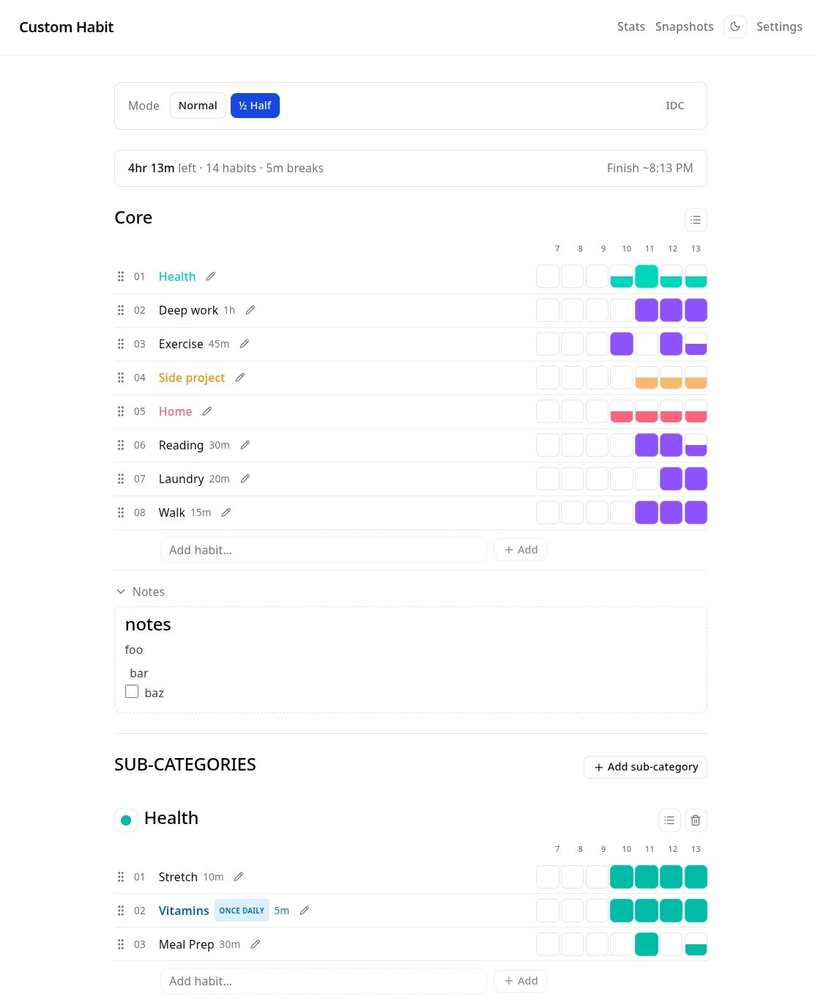

# customhabit

A personal habit tracker inspired by Obsidian tally markers. Track Core habits and optional sub-category tables with drag-and-drop reordering, a click-to-tally date grid, and markdown notes per table.



> [more screenshots](./screenshots/screenshots.md)

## Features

- **Core table** — your main habit list; always present
- **Sub-categories** — optional grouped tables; each one auto-adds a linked row in Core
- **Linked rows** — Core row checks off when all habits in that sub-category are done for the day
- **Tally grid** — click a date cell to toggle completion (default: last 7 days; configurable in Settings)
- **Drag-and-drop** — reorder habits within any table
- **Markdown notes** — optional notes under each table with live preview; auto-saved
- **Day-run bar** — normal or half mode (two-tap half-fill), plus tap-out (IDC)
- **Stats** — activity heatmap and streak tracking
- **Board snapshots** — save and restore habit layouts
- **Retired habits** — remove from active boards without losing history
- **Settings** — lookback window, day timing, and other preferences
- **Light/dark theme**

## Architecture

You get one **Core** table plus optional **sub-category** tables. Sub-categories auto-add a linked row in Core, so you can see the big picture and drill into groups (work, health, chores, etc.) without duplicating habits.

Click date cells to tally completions, drag habits to reorder, and jot markdown notes under each table. Stats, snapshots, and day-run timing are built in — but at its core it's a tally grid with SQLite behind it.

```
browser → :8005
           ├── /api/*   → FastAPI route handlers
           └── /*       → React SPA (built static files served by FastAPI)
```

## Install/setup

Have [Docker](https://docs.docker.com/get-docker/) installed (Compose V2 included).

1. Create a folder and put this `docker-compose.yml` in it:

```yaml
services:
  app:
    image: willmarl/customhabit:latest
    ports:
      - "1234:8005"
    volumes:
      - customhabit-data:/app
    restart: unless-stopped

volumes:
  customhabit-data:
```

2. Start (or upgrade) the app:

```bash
docker compose pull && docker compose up -d
```

3. Open `http://<your-pc-ip>:1234/` (e.g. `http://192.168.0.230:1234/`).

SQLite is created on first run. The `customhabit-data` volume keeps `/app/database.db` across restarts and upgrades — no extra setup.

To change the host port, edit the left side of `"1234:8005"` (container stays on `8005`).

## Tech stack

- (Backend) FastAPI
  - SQLite DB
- (Frontend) Vite + React
